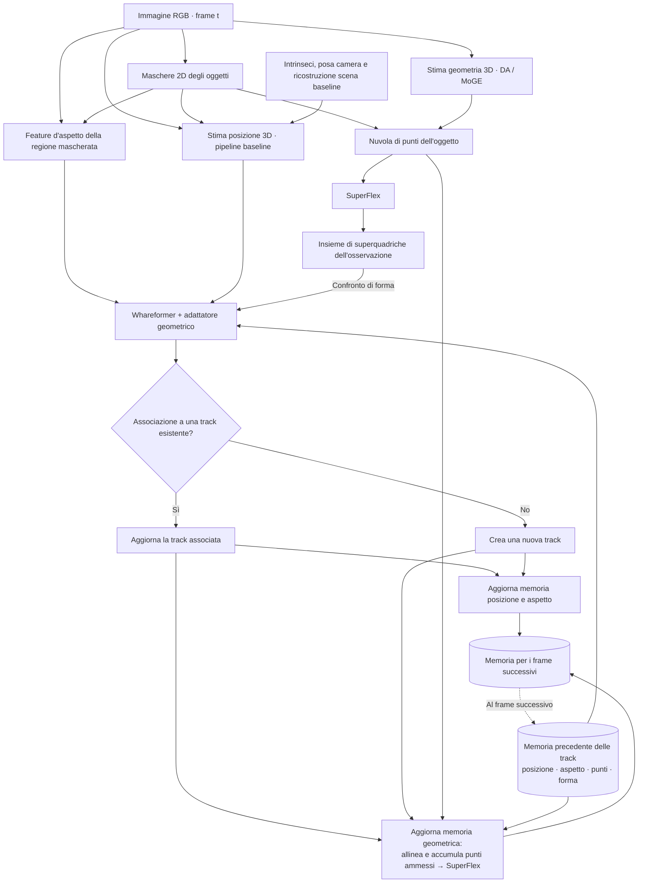

# Mappa del sistema obiettivo — 14 novembre 2026

## SuperFlex differita collegata — 14 novembre

Implementate richieste da nuvola/versione ammessa, worker sulla pipeline esistente, verifica/importazione e pubblicazione della forma nei soli frame successivi. Replay seriale bloccato fino agli esiti, ultima forma conservata su fallimento; completamenti esclusi dai punti osservati. 43 controlli locali passati con sostituti dichiarati, nessuna nuova inferenza reale/HPC. Runner predisposto con --accumulate --reconstruct; prossimo confronto comune delle varianti e aggregazione delle misure. [SUPERFLEX_DIFFERITA_20261114.md](SUPERFLEX_DIFFERITA_20261114.md). Le note precedenti sul collegamento SuperFlex ancora mancante sono storiche; validazione reale 2B e risultati HPC pendenti invariati.

## Registrazione/accumulo collegati — 14 novembre

Collegato il candidato esistente al coordinatore: inizializzazione, registrazione rigida e accumulo ammesso, con isolamento delle sorgenti, versioni/provenienza e conservazione dello stato su rifiuto/errore. 35 test locali passati; input sintetici e componenti controllati, nessun replay reale o HPC. Runner predisposto con --accumulate (default disattivato), preparatore con punti camera/hash; non eseguiti in questa fase. Prossimo: SuperFlex differita dalla nuvola accettata. Il matcher usa ancora forme separate; risultato reale 2B invariato (0/12). [COLLEGAMENTO_ACCUMULO_20261114.md](COLLEGAMENTO_ACCUMULO_20261114.md). Le indicazioni precedenti sul collegamento ancora mancante sono storiche.

Rappresentazione concettuale richiesta da Marco: RGB → maschera e nuvola → SuperFlex → associazione Whareformer con posizione, aspetto e forma → aggiornamento delle memorie. Esplicita il ciclo già approvato; non certifica che sia interamente implementato o validato. Contratto dettagliato: [ROADMAP_CICLO_GEOMETRICO.md](ROADMAP_CICLO_GEOMETRICO.md). Stato software: [INTEGRAZIONE_RIUTILIZZABILE_20261114.md](INTEGRAZIONE_RIUTILIZZABILE_20261114.md).

## Lettura e limiti

- **Input delle maschere:** nello sviluppo corrente si usano annotazioni VISOR. Il blocco maschere rappresenta la loro disponibilità nel flusso; non dichiara un segmentatore RGB già implementato né una scelta di SAM3.
- **Aspetto:** la maschera seleziona la regione da cui estrarre le feature. La memoria baseline conserva una rappresentazione d'aspetto, non semplicemente una sequenza di maschere binarie. La posizione usa la pipeline/XYZ originale della baseline; non viene sostituita automaticamente con il centro della nuvola DA/MoGE e non equivale alla posa 6D dell'oggetto.
- **Contributo SuperFlex:** il blocco di associazione comprende Whareformer e l'adattatore. Le superquadriche contribuiscono attraverso un confronto geometrico; non sono un terzo ingresso nativo della rete originale. La correzione dei logits è il candidato implementato, con reti congelate; distanza e peso scientifici restano da validare.
- **Aggiornamento geometrico:** per una track esistente si propone la registrazione della vista, si ammettono soltanto aggiornamenti affidabili e si ricostruisce la forma dai punti osservati accumulati quando previsto dalla politica di aggiornamento. Per una nuova track si inizializza dalla prima osservazione valida. Non si mediano i parametri delle primitive e non si reinserisce il completamento predetto come evidenza osservata.
- **Causalità e fallimenti:** tutte le detection del frame leggono la stessa memoria precedente; si risolvono tutte le associazioni prima degli aggiornamenti. Un rifiuto geometrico o un fallimento SuperFlex conserva l'ultima forma valida, senza annullare retroattivamente il matching. Se manca geometria utilizzabile, resta il percorso baseline. Una track senza osservazione associata non riceve nuova evidenza e segue la gestione baseline del ciclo di vita.
- **Stato effettivo:** il collegamento riutilizzabile del matcher è implementato e controllato localmente; coordinatore e ciclo accumulativo completo restano da sviluppare. Registrazione reale non validata: 0/12 aggiornamenti ammessi nei piloti precedenti. La figura descrive il risultato atteso, non un beneficio tracking dimostrato né una pipeline RGB strettamente online già verificata.

## Output atteso

Per ogni osservazione: associazione a un ID di track esistente oppure creazione di una nuova track. Per ogni track: memoria di posizione e aspetto e stato geometrico con punti osservati, provenienza e ultima rappresentazione SuperFlex valida, riutilizzabili nelle associazioni successive.

## Provenienza della posizione EPIC verificata nel codice locale

Chiarimento del 14 novembre: il ramo posizione dipende da RGB, maschera/bounding box, intrinseci e posa camera EPIC Fields, oltre alla ricostruzione della scena. Nel sorgente originale disponibile, `load_depth_model` usa Depth Anything V2 Metric Indoor Large. `_align_and_lift_frame` allinea la profondità predetta a quella renderizzata dalla scena sulle regioni ammesse. `lift_object_centroid` usa il centro della bounding box e la mediana della profondità nella maschera; `lift_to_3d` retroproietta con gli intrinseci e applica la posa camera per ottenere XYZ nel riferimento della scena. Non è il centroide completo della nuvola né un output delle feature d'aspetto. Le maschere alimentano quindi sia aspetto sia posizione e selezione dei punti. Questo dettaglio corregge l'indicazione precedente troppo generica di un semplice ramo separato dall'RGB.

Fonti lette: `Whareformer-repo/src/feature_extraction/extractors/epic_extractor.py:120`, `utils/epic_utils.py:47,87`, `datasets/epic_dataset.py:21` e `utils/models.py:110` nella stessa cartella `feature_extraction`. Verifica del codice locale, senza rigenerazione o certificazione retrospettiva della provenienza di ogni XYZ precalcolato. Nessuna nuova scelta metodologica.
